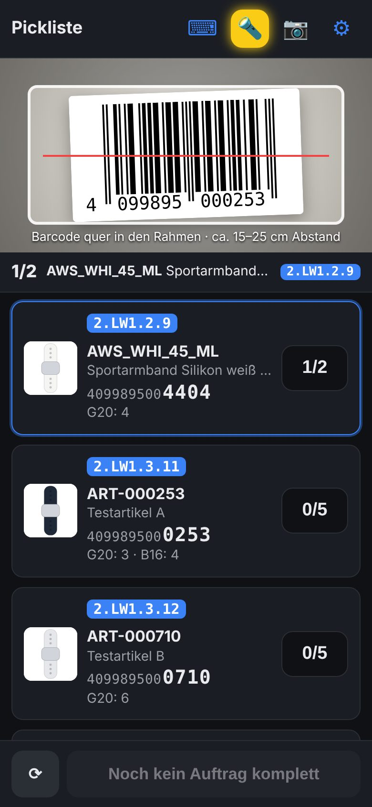
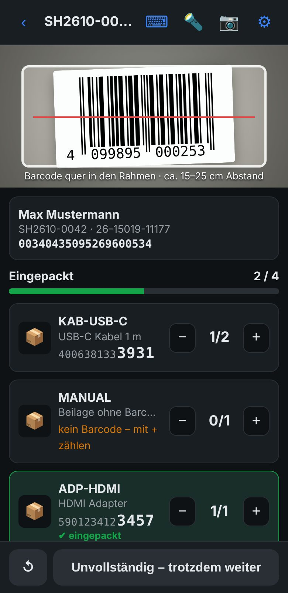
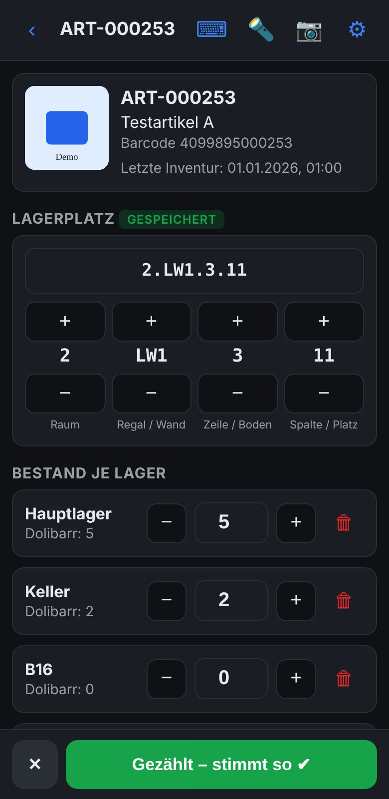

# PackScan & Inventur for Dolibarr

**Mobile barcode picking, packing verification and stock counting — powered by your own Dolibarr.**

PackScan and Inventur (Inventory) are two free, open-source web apps for iPhone and Android. Turn your smartphone into a warehouse scanner: find products by storage location, verify items before shipping, and update stock directly in Dolibarr.

Built by Stefan Grumpelt at **gRoods.de** for daily use in a real online shop and warehouse.

[Project website](https://groods.de/packscan/) · [Try PackScan](https://groods.de/demo/packscan/) · [Try Inventur](https://groods.de/demo/inventur/) · [Setup guide (German)](https://groods.de/packscan/anleitung.html) · [Download installation ZIP](https://groods.de/packscan/download/lager-apps.zip)

## Screenshots

| Pick by storage location | Verify items while packing | Count stock by warehouse |
| --- | --- | --- |
|  |  |  |

Screenshots show the German interface with example data. Both apps also support English and 22 other languages.

## At a glance

| | PackScan | Inventur / Inventory |
| --- | --- | --- |
| Main task | Pick orders and verify items while packing | Count stock and maintain storage locations |
| Scan | Product barcodes and shipment labels | Product barcodes or an additional GTIN field |
| Display | Product images, locations, quantities and packing progress | Product images, storage locations and stock by warehouse |
| Update Dolibarr | Mark orders as picked; validate shipments and close orders according to settings | Save location changes, stock adjustments and the last-count timestamp |

- **Self-hosted:** static application files, no additional application backend or database.
- **Direct integration:** communicates with your Dolibarr through its REST API.
- **Mobile first:** runs in Safari on iPhone and Chrome on Android; add an icon to your home screen.
- **24 languages:** follows the browser language, with a manual language setting.
- **No mandatory subscription:** the apps are free; professional setup is optional.

## PackScan: from shelf to parcel

### Pick efficiently

- Combine open orders into a picking list sorted by storage location.
- Group identical products across orders to avoid repeated trips.
- See product images, stock information and prominent barcode end digits.
- Scan each product or enter quantities for multiple identical items.
- Exclude postage and other non-pickable products in settings.

### Find the right location

Tap a storage location to display a visual wall or shelf grid. The target location and other products needed on the same wall are highlighted.

Location codes describe the physical route through your warehouse. For example:

`2.LW1.3.12` = room 2, wall LW1, row 3, column 12.

The final two parts identify row and column; preceding parts describe the room, shelf or other structure.

### Release complete orders

Allocate picked quantities to the oldest orders first. Complete orders can be released, while incomplete orders remain pending. Surplus quantities are shown so they can be returned to storage.

### Verify every parcel

- Scan a shipment label to open the matching Dolibarr shipment.
- Scan items before placing them in the parcel or envelope.
- Receive visual and audible feedback for correct and incorrect items.
- Validate the shipment and close the order when packing is complete, according to your settings.

Label lookup supports shipment numbers on DHL labels and the Data Matrix code on Deutsche Post Internetmarke labels. The shipment number must already be recorded in the Dolibarr shipment.

## Inventur: count stock where it is stored

- Find products using their standard barcode or an additional GTIN field.
- View product information, images, storage locations and quantities by warehouse.
- Assign or update storage locations; suggest the next column when placing new products sequentially.
- Adjust quantities for the selected warehouses.
- Save the last-count date and time and receive a warning if a product has already been counted that day.

**Scanning alone does not change stock.** Selecting **Save** posts the difference immediately as a Dolibarr stock movement with an `INV`-prefixed inventory reference. The app reloads the current stock before posting.

There is currently **no separate count sheet or expected-versus-counted export**. Review and export inventory movements in Dolibarr, and use the last-count field to identify products that have not yet been counted.

## Scanning and mobile operation

- Camera scanning for EAN, Code 128, QR and Data Matrix.
- Built-in ZXing-based barcode recognition.
- Torch control on supported devices and browsers.
- Audible feedback and visual confirmation.
- Protection against repeatedly counting a barcode that remains in view.
- Bluetooth scanners that act as a keyboard can use the input field.
- Product images can be enlarged for easier identification.

## Try the demos

Open a demo on your smartphone to explore sample orders, storage locations and packing workflows:

- [PackScan demo](https://groods.de/demo/packscan/)
- [Inventur demo](https://groods.de/demo/inventur/)

No registration is required. Demo data does not affect a live Dolibarr system.

For testing with your own Dolibarr, self-hosting the files on the same origin is the most reliable option. Cross-origin connections from the public demo may be blocked by your server, proxy or security configuration. Start with a dedicated read-only API user when exploring live data.

## Requirements

| Component | Requirement |
| --- | --- |
| Dolibarr | Developed and used with version 24; older versions require compatibility checking |
| Connection | HTTPS and a reliable connection from the device to Dolibarr |
| Browser | Safari on iPhone, iOS 16 or later; Chrome on Android |
| Dolibarr modules | Products, Stock/Warehouses, Customer Orders, Shipments and REST API for the complete workflow |
| Product data | Product barcodes and configured storage-location fields |
| Access | Dedicated Dolibarr API user with permissions appropriate to the features used |

For the documented shipping setup, configure DHL and Deutsche Post shipping methods in Dolibarr. Their codes can be adjusted in the app settings.

## Installation

1. Download and extract the [installation ZIP](https://groods.de/packscan/download/lager-apps.zip), or obtain the application files from this repository.
2. Create `htdocs/custom/lager/` in your Dolibarr installation.
3. Copy the **contents** of the package's `lager-apps` folder into that directory. Keep the HTML files, manifests and icons together.
4. Prepare the required Dolibarr modules, extra fields, shipping methods and API permissions.
5. Open `https://your-dolibarr.example/custom/lager/` on your smartphone and choose an app.
6. Open settings, enter the Dolibarr API address and token, and test the connection. Disable demo mode if enabled.
7. Check warehouse and stock-movement settings before using live orders or saving stock adjustments.
8. Optionally add each app to your home screen.

These are standalone browser apps using the REST API. The supplied files do not constitute a conventional Dolibarr module installed through the external-module installer.

### Extra fields

Default field codes are shown below; relevant codes can be changed in the app settings.

| Code | Dolibarr object | Type | Purpose |
| --- | --- | --- | --- |
| `lagerplatz` | Product | Text | Storage location, picking order and grid display |
| `gtin` | Product | Text, optional | Additional product barcode |
| `letzte_inventur` | Product | Date and time | Last stock count |
| `gepickt` | Customer order | Date and time | Release after picking |
| `umgebucht` | Customer order | Date and time | Used by the optional shipping automation to track stock transfers |

### API permissions

The complete workflow needs access to read and update products, read warehouses and create stock movements, read/update/close orders, read/create/validate shipments, and read third parties. Grant only the permissions needed for the app and workflow being used.

See the [detailed API setup guide](https://groods.de/packscan/anleitung.html#api).

### Avoid duplicate stock deductions

Review Dolibarr's stock configuration carefully. If stock has already been deducted when an order or invoice is validated, shipment validation must not deduct it again. Configure the stock trigger to match your workflow before completing shipments in PackScan.

## Included apps versus optional integrations

| Included in the free apps | Requires a separate integration |
| --- | --- |
| Barcode picking and storage-location display | Importing orders from marketplaces or shops |
| Release of fully picked orders | Buying postage or generating DHL/Internetmarke labels |
| Shipment lookup and packing verification | Sending tracking numbers back to marketplaces |
| Shipment validation and order completion | Server-side shipping automation and custom workflows |
| Stock adjustments and location maintenance | Individual implementation and consulting services |

The optional shipping automation is a separate server-side solution. It is **not included** in the free app download. Without it, create labels using your shipping tool and prepare the corresponding shipments in Dolibarr.

## Limitations and concurrent use

- **Connectivity:** loading lists, looking up products and saving changes require access to Dolibarr. Local picking and packing progress is retained on the device after a connection interruption; this is not a fully offline workflow.
- **Picking:** progress is device-local. Use one picker per picking run.
- **Packing:** multiple people can pack in parallel when each works on a different shipment.
- **Inventory:** coordinate counts so people do not update the same product and warehouse simultaneously. Reloading stock before saving is not a reservation or lock.
- **Partial shipments:** create genuine partial shipments in Dolibarr. Completing packing with missing items does not automatically reduce the shipment's recorded quantities.
- **Sets:** a set is handled as one product with its own barcode; components of a Dolibarr kit are not expanded.
- **Variants:** each variant is handled as a separate product with its own barcode.
- **Lots and serial numbers:** use Dolibarr for their stock corrections. Location maintenance remains available in the app.
- **Products without a barcode:** count manually using the quantity controls.

## Data and access

Business records remain in your Dolibarr. The browser also stores the API address, API token, settings and local workflow progress on the device. Camera images are processed locally and are not uploaded by the apps.

Use a dedicated API user. If a device is lost, revoke its access by renewing the relevant user's API token in Dolibarr. Resetting the app settings clears its locally stored connection settings.

## Languages

Version **1.1.0** adds 24 interface languages: Bulgarian, Croatian, Czech, Danish, Dutch, English, Estonian, Finnish, French, German, Greek, Hungarian, Italian, Latvian, Lithuanian, Norwegian, Polish, Portuguese, Romanian, Slovak, Slovenian, Spanish, Swedish and Ukrainian.

The apps follow the browser language by default, fall back to English for unsupported languages, and allow a manual language selection in settings.

## Updates

Replace the application files on your server with the new version, keeping the same application URLs. Browser-stored settings remain on each device. The installed version appears in the app settings.

See the [version history](https://groods.de/packscan/#versionen) for changes.

## Support and professional setup

Self-installation is free. Optional paid services include setup, training, warehouse-process advice and custom integrations. Current packages and contact details are available on the [project website](https://groods.de/packscan/).

- **Author:** Stefan Grumpelt, gRoods.de
- **Email:** [info@groods.de](mailto:info@groods.de)
- **WhatsApp Business:** +49 351 16078332

When reporting an issue, include the app version, Dolibarr version, browser/device and steps to reproduce it. Do not publish API tokens, credentials or customer data.

## License and acknowledgements

Copyright © 2026 Stefan Grumpelt, gRoods.de.

PackScan and Inventur are licensed under the **GNU General Public License v3.0 or later**. See [LICENSE](LICENSE) for the full license text.

`SPDX-License-Identifier: GPL-3.0-or-later`

The software is provided without warranty, as described in the license.

Barcode recognition uses **ZXing-C++** (Apache-2.0) through **zxing-wasm** (MIT). Internetmarke Data Matrix decoding follows the approach used by **BinaryEye** (MIT). Third-party components retain their respective licenses and notices.

Dolibarr, eBay, DHL and Deutsche Post are trademarks of their respective owners. This project is an independent extension and is not an official product of those providers.
